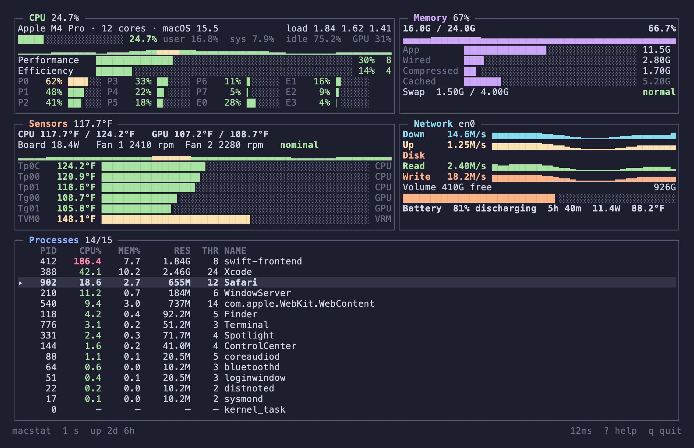
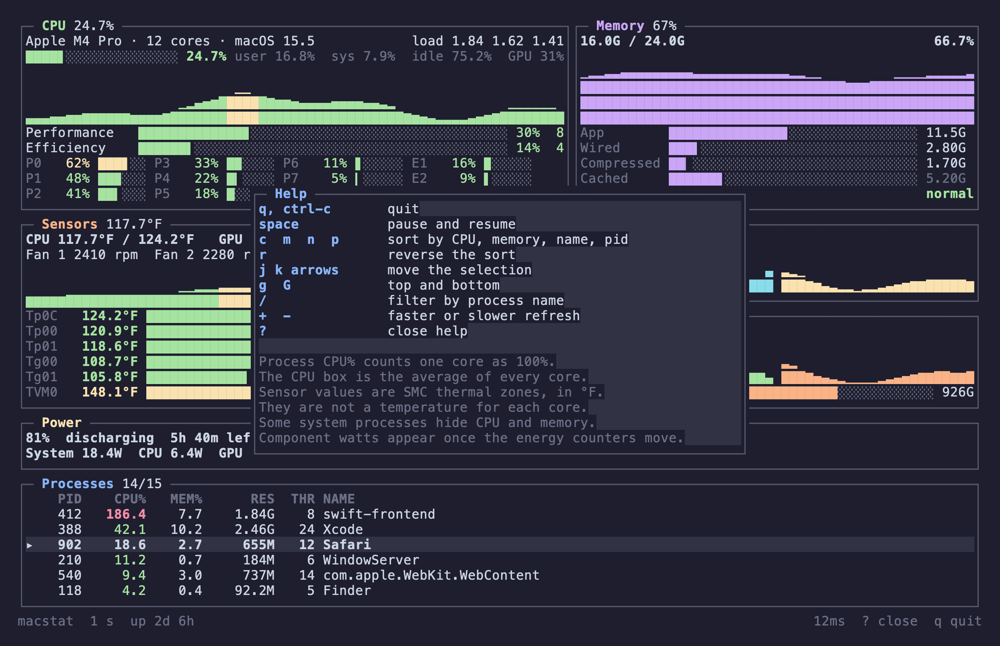

# macstat

A full-screen terminal monitor for Mac CPU, memory, temperatures, fans, network, disk, battery, and processes. It is a Swift package with no dependencies.



The pictures use a built-in fixture, `macstat --preview`, so they are not a capture of a live machine.

## Run

macOS 14 or later.

```bash
swift run
swift run macstat --once
swift build -c release
```

The release binary is `.build/release/macstat`. `--interval` / `-i` sets the refresh from 0.25 to 10 seconds. The default is 1 second. If stdout is not a terminal, macstat prints one snapshot and exits.

`MACSTAT_THEME=light` or `MACSTAT_THEME=dark` picks the palette.

## Keys

| Key | Action |
| --- | --- |
| `q`, ctrl-c | Quit |
| space | Pause |
| `c` `m` `n` `p` | Sort by CPU, memory, name, or pid |
| `r` | Reverse the sort |
| `j` `k`, arrows | Move the selection |
| `g` `G` | Top and bottom |
| page up/down, ctrl-u/ctrl-d | Move by a page |
| `/` | Filter process names |
| `+` `-` | Change the refresh interval |
| `?` | Help |



## Readings

Temperatures come from the SMC and are shown in °F. They are thermal zones, not a sensor for each core.

The CPU percentage is the average across every core. In the process list, 100% means one core is fully busy, so a process can go past 100%.

Battery charge, time remaining, and cycle count come from the battery service and are shown in the Power box. While it is charging, the time shown is the estimate until full. CPU, GPU, DRAM, ANE, and display watts come from the energy counters. They stay hidden until a counter changes more than once, then show the average over that gap. At idle the counters can sit still for a long time, so that line stays blank. System watts, also in the Power box, are the SMC total and can differ from the battery reading.

macOS hides task info for some system processes, including `kernel_task`. Those rows still appear, with a dash where CPU and memory would be.

## Screenshots

Regenerate the images from the fixture:

```bash
swift build
swiftc -framework AppKit -o /tmp/macstat-shot scripts/render-preview.swift
/tmp/macstat-shot .build/debug/macstat docs/dashboard.png docs/help.png
```

## License

[MIT](LICENSE)
